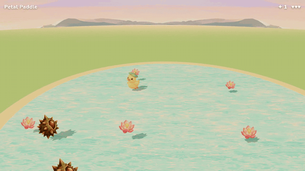

# Self-Supplying Agent: a coding agent that makes its own game assets on GMI Cloud

**Petal Paddle** is a small, cozy three.js pond game. You steer a duckling, collect lotus blossoms and dodge drifting spiky burs.
No asset in this repo was made by hand. An LLM on GMI Cloud designed the game and wrote the generation prompts. The soundtrack prompt was rewritten after the first song came out badly. GMI's media models then generated the textures, sprites, soundtrack and voice line in the middle of the build. The only things written by hand are the code and an empty pond (a few colored primitives).

<p align="center">
  
</p>

<p align="center">🔊 <a href="shots/demo.mp4">Watch with sound (demo.mp4)</a></p>

## What's generated, and by which model

<!-- numbers -->
| asset | model | status | gen time | cost | output |
|---|---|---|---|---|---|
| design | `google/gemini-4-carbon` | success | 70.6s | $0.01652 | 2049 tokens |
| player | `hunyuan-3d-pro` | failed | 2s | — | submit hunyuan-3d-pro HTTP 500: {"error":"hunyuan api error [ResourceInsufficient]: Resour |
| collectible | `hunyuan-3d-pro` | failed | 2.9s | — | submit hunyuan-3d-pro HTTP 500: {"error":"hunyuan api error [ResourceInsufficient]: Resour |
| obstacle | `hunyuan-3d-pro` | failed | 3.9s | — | submit hunyuan-3d-pro HTTP 500: {"error":"hunyuan api error [ResourceInsufficient]: Resour |
| ground | `seedream-5.0-lite` | success | 27s | $0.035 | assets/ground.png |
| sky | `seedream-5.0-lite` | success | 25s | $0.035 | assets/sky.png |
| music | `minimax-music-3.0` | success | 84s | $0.15 | assets/music.mp3, assets/alt_music/v4_kalimba_lofi.mp3 |
| voice | `minimax-tts-speech-2.8-turbo` | success | 13s | $0.0049 | assets/voice.mp3 |
| player_sprite | `gpt-image-2.5-flare-generate` | success | 11s | $0.0132 | assets/player_sprite.png |
| collectible_sprite | `gpt-image-2.5-flare-generate` | success | 11s | $0.0132 | assets/collectible_sprite.png |
| obstacle_sprite | `gpt-image-2.5-flare-generate` | success | 16s | $0.0132 | assets/obstacle_sprite.png |

**Total spend: $0.281** (media $0.2645 + LLM $0.01652) · 7 assets generated · 164s of summed generation time (jobs run in parallel)

**Soundtrack iterations** (minimax-music-3.0, $0.15 each, checked with ffmpeg plus a gemini-4-carbon listen for vocals):

| variant | gen time | listen check | 10s preview |
|---|---|---|---|
| music_v0_original | 61s | original song with vocals, replaced after feedback | — |
| v1_kalimba_lofi | 62s | vocals (wordless female humming) | [preview](shots/music_previews/v1_kalimba_lofi_10s.mp3) |
| v2_plucked_guitar | 82s | vocals (gibberish lyrics) | [preview](shots/music_previews/v2_plucked_guitar_10s.mp3) |
| v3_marimba_bossa | 83s | vocals + clipping (flat factor >1) | [preview](shots/music_previews/v3_marimba_bossa_10s.mp3) |
| v4_kalimba_lofi | 84s | no vocals, no clipping (peak -0.3 dB), only tail silence → CHOSEN | [preview](shots/music_previews/v4_kalimba_lofi_10s.mp3) |
| v5_plucked_guitar | 72s | vocals at start | [preview](shots/music_previews/v5_plucked_guitar_10s.mp3) |
| v6_marimba_bossa | 105s | vocals + heavy clipping (flat factor ~10) | [preview](shots/music_previews/v6_marimba_bossa_10s.mp3) |

All-in spend including the rejected songs and listen checks: **$1.27**
<!-- /numbers -->

> **About the 3D meshes:** for this build, `hunyuan-3d-pro` rejected every submit with `[ResourceInsufficient] Resources are insufficient.` (about 60 attempts between 11:57 and 12:25 UTC on 14 Nov 2026). The failure is on the provider side and nothing was charged. The game is already wired for meshes (GLB, OBJ+MTL and FBX, including zipped output). Run `node pipeline/supply.mjs` again once Hunyuan has capacity: it skips the cached assets, fetches only the three meshes, and the game swaps the sprites for 3D models without any code changes.

A clean run takes about 2.5 minutes from start to finish: roughly 70 seconds of design, then every media job in parallel, with music being the slowest at about 60 seconds.

The full log is in [`assets/manifest.json`](assets/manifest.json). It records the model, request id, timings, prompt payload and cost for each step. The cost numbers come from GMI's own price list (`/requestqueue/models` → `price_info`, in micro-dollars) and from the `/v1/models` token pricing.

## How it works

```
gemini-4-carbon ──► game_spec.json (title, rules, palette, 3 mesh prompts, 2 texture prompts, song, voice line)
        │
        ├─► hunyuan-3d-pro          player / collectible / obstacle meshes   (async queue)
        ├─► gpt-image-2.5-flare     transparent sprites of the same 3 things (also the fallback)
        ├─► seedream-5.0-lite       tileable water texture + painted sky panorama
        ├─► minimax-music-3.0       instrumental lo-fi soundtrack (6 takes, best one kept)
        └─► minimax-tts-2.8-turbo   "welcome to the pond" voice line
                       │
                       ▼
           assets/ + manifest.json  ──►  src/main.js loads assets ONLY by manifest id
```

The game never hard-codes an asset path. It reads `manifest.json` and uses a 3D mesh for each entity when one exists. If the mesh is missing, it uses the GMI sprite as a billboard.

## Tutorial

### 1. Get a key
Create an Inference Engine API key in the [GMI console](https://console.gmicloud.ai). Keep it out of git:

```bash
echo "GMI_API_KEY=..." > .env    # .env is in .gitignore
export $(cat .env)
```

### 2. Give your coding agent the GMI MCP server
`.mcp.json` (Claude Code), `.cursor/mcp.json` (Cursor) and `.codex/config.toml` (Codex) all point at the same server:

```json
{ "mcpServers": { "gmi": { "type": "http", "url": "https://mcp.gmicloud.ai/mcp" } } }
```

The first time the agent uses a GMI tool, a browser sign-in opens. After that, the agent has `search_models`, `get_model`, `estimate_generation`, `submit_generation` and `get_generation`. [`AGENTS.md`](AGENTS.md) tells it how to use them: never ask the human for an asset, read the model's real parameters, price the job, submit it, poll until it's done, save the file to `assets/` and log it in the manifest.

A prompt that kicks the whole thing off:

> Build a tiny cozy three.js pond game. Don't ask me for any files. Design it, then generate every mesh, texture and sound you need through the gmi MCP tools, log each one in assets/manifest.json with its cost, and load assets only through the manifest.

### 3. Or run the same loop headless
`pipeline/supply.mjs` makes the same calls over plain REST, which is handy in CI or when the MCP sign-in isn't available. It needs Node 18+ and has no dependencies.

```bash
node pipeline/supply.mjs           # design + generate everything (resumes; cached assets are skipped)
node pipeline/supply.mjs --fresh   # new game design from scratch
node pipeline/report.mjs --write   # refresh the numbers table in this README
```

The two endpoints it uses:

| what | endpoint |
|---|---|
| LLM (OpenAI-compatible) | `POST https://api.gmi-serving.com/v1/chat/completions` with `model: google/gemini-4-carbon`, `response_format: json_object` |
| media (3D, image, music, TTS) | `POST https://console.gmicloud.ai/api/v1/ie/requestqueue/apikey/requests` with `{ "model", "payload" }`, then `GET …/requests/{id}` until `status: success`, then download `outcome.media_urls` |

The real payloads that were sent are saved in the manifest. Some examples:

```jsonc
// hunyuan-3d-pro
{ "prompt": "<LLM-written prompt>. Cute stylized low-poly game asset…", "generate_type": "Normal", "face_count": 40000 }
// gpt-image-2.5-flare-generate (sprites)
{ "prompt": "…transparent background.", "size": "1024x1024", "quality": "medium", "background": "transparent", "output_format": "png" }
// seedream-5.0-lite
{ "prompt": "Seamless tileable top-down texture for a calm pond…", "size": "2048x2048", "output_format": "png" }
// minimax-music-3.0 (instrumental: structure tags only, no words)
{ "lyrics": "[Inst]\n\n[Inst]\n\n[Interlude]\n\n[Inst]\n\n[Solo]\n\n[Inst]",
  "prompt": "Lo-fi cozy game loop, 88 BPM, soft kalimba lead melody, warm Rhodes chords, mellow brushed drums… Pure music, instrumental only, no vocals…",
  "format": "mp3", "lyrics_optimizer": false }
// minimax-tts-speech-2.8-turbo
{ "text": "Welcome to the pond, little friend…", "voice_id": "English_radiant_girl", "format": "mp3" }
```

### 4. Play it

```bash
npm install
npx vite            # dev server on http://localhost:5173
npx vite build && npx vite preview   # production build
```

WASD, the arrow keys or click-drag to steer. Add `?demo` to the URL for autopilot (that's how the recording was made).

### 5. Check it headless

```bash
npx playwright install chromium
node pipeline/shoot.mjs   # screenshots + webm into shots/, plus shots/check.json (score, music playing, which assets loaded)
```

## Things I learned

- **Read the parameter enums.** Seedream wants a total pixel count between 3.6M and 10.4M, so `1024x1024` is rejected and `2048x2048` works. Hunyuan's `face_count` floor is 40,000.
- **Upstream providers get busy.** During this build, `hunyuan-3d-pro` kept returning `ResourceInsufficient` at submit time. The pipeline retries every 45 seconds, and the game falls back to the GMI sprite for any entity that has no mesh. Nothing gets faked with a local generator.
- **"Please retry" means it.** One TTS job failed with `INTERNAL_ERROR` and the resubmit went through. The pipeline retries a job up to 3 times.
- **Getting instrumental music out of a song model.** `minimax-music-3.0` requires lyrics. Tags like `[Instrumental]` under `[Verse]` and `[Chorus]` still produced humming and made-up words in all 3 takes. Using only `[Inst]`, `[Interlude]` and `[Solo]` tags, with `lyrics_optimizer: false` and "pure music, no vocals" in the style prompt, gave 1 clean take out of 3. I re-ran it with `node pipeline/music.mjs`, checked each take for clipping and silence with ffmpeg, and had gemini-4-carbon listen to the audio and flag vocals.
- **Let the LLM write the prompts.** The style held together across six different models because a single design spec wrote every prompt (palette, "low-poly pastel", golden hour).

## Files

```
pipeline/supply.mjs   design + generate + download + manifest
pipeline/report.mjs   manifest → markdown numbers
pipeline/shoot.mjs    headless playwright check + recording
src/main.js           the game (three.js), loads assets by manifest id only
assets/               everything GMI generated + manifest.json + game_spec.json
shots/                screenshots, demo.mp4, demo.gif, check.json
AGENTS.md, .mcp.json  coding-agent setup for the GMI MCP server
```
